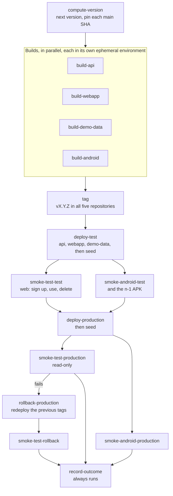

# mootmaker-release

The release pipeline. One run of `release.yml` versions, builds, tests and tags every component together:
mootmaker-api, mootmaker-webapp and mootmaker-demo-data, plus the mootmaker-android APK. It then promotes
them through `test` to `production`, with smoke tests at each stage, and records the outcome as a
GitHub Release. It is the only way `test` and `production` change.

A release runs only when someone starts it. Merging to `main` in any repository deploys nothing.

```bash
gh workflow run release.yml -R geoffweatherall/mootmaker-release -f bump=patch   # or minor, major
```

The whole delivery process, including pull requests and ephemeral environments, is in the hub's
[delivery overview](https://github.com/geoffweatherall/mootmaker/blob/main/docs/overview/delivery.md).
The design and its reasoning are in
[ci-cd-pipeline.md](https://github.com/geoffweatherall/mootmaker/blob/main/designs/archive/ci-cd-pipeline.md).

## The pipeline



| Stage | What it does |
|---|---|
| `compute-version` | Reads the latest version from this repository's GitHub Releases, failed ones included, and applies the bump. Pins each component's `main` commit, so every later stage builds and tags the same code even if something merges mid-release |
| `build-*` | Calls each component's own `release-build.yml`, which builds once, proves the build with its full acceptance suite in a fresh ephemeral environment (`rel-api-*`, `rel-web-*`, `rel-demo-*`, `rel-and-*`) and uploads it. Once one build fails, the others stop early |
| `tag` | Pushes `vX.Y.Z` to all five repositories, only once every build has passed, so a tag always names a proven commit |
| `deploy-test` | Deploys the three deployable components' built artifacts to `test`, then runs demo-data |
| `smoke-test-test` | Playwright (`smoke/tests/test-stage.spec.ts`): signs up with a real emailed code, uses the app, deletes the account |
| `smoke-android-test`, `smoke-android-n-1-test` | Maestro, with the new APK and with the previous release's APK. Installed phones are not updated when the API changes, so the previous app must still work |
| `deploy-production` | The same artifacts to `production`, then runs demo-data |
| `smoke-test-production`, `smoke-android-production` | Read-only checks with the demo account; nothing is written to production |
| `rollback-production`, `smoke-test-rollback` | Only if the web production smoke fails: redeploys the previous release's tags, and smoke-tests them |
| `record-outcome` | A GitHub Release with the APK and its SHA-256 on success. A `FAILED` prerelease if it tagged and then failed. An issue if it failed before tagging |

Things that are easy to break by rearranging jobs, and are commented in the workflow:

- **Tags are pushed only after every build passes.** A failed release never reuses its version; nothing
  is ever un-tagged.
- **`record-outcome` runs with `if: always()` and decides from the tag job's own output**, not from
  whether later jobs passed. Otherwise a run that failed after tagging would leave tags with nothing
  recording them.
- **Only the web smoke test decides rollback.** An Android failure on `production` stops the APK being
  published and marks the release failed, but does not roll back a working backend.
- **A demo-data seeding failure stops the release without rolling back.** Reverting a good deploy
  because demo content failed would not help.
- **Overlapping runs queue** (`concurrency: release`, not cancelled), so two releases never race on the
  version, the tags or a deploy.
- **Without the Android signing secret, every Android stage is skipped** and the other three components
  still ship.

## Before starting a release

Nothing in the pipeline decides whether now is a good time, so the person or agent starting it does.

1. **Scan the open issues in every repository the release touches**, not just the one with the change:

   ```bash
   for r in mootmaker mootmaker-api mootmaker-webapp mootmaker-demo-data mootmaker-android mootmaker-release; do
     echo "=== $r ==="
     gh issue list --repo geoffweatherall/$r --state open --limit 40 --json number,title \
       --jq '.[] | "#\(.number)\t\(.title)"'
   done
   ```

   Look for three things. First, a manual step that a design expects before the release, which the
   pipeline has no step for. Second, a known-broken path that this release will exercise for the first
   time. Third, anything that changes how far automatic rollback can be trusted. An issue about a bug the
   release does not touch is not a reason to wait.
2. **Re-check any fact a design recorded about a particular day** (for example, what is in
   `production`'s user pool) rather than inheriting it.
3. **Check that each component's `main` is what you mean to ship.** Whatever is merged when
   `compute-version` runs is in the release, including work nobody had this release in mind for.
4. **Choose the bump knowing a failed attempt uses up its version.**

**Retry a failed release with `patch`**, whatever the failed attempt used. Its bump has already been
applied: a failed `major` from `v1.0.2` used up `v2.0.0`, and `patch` makes the retry `v2.0.1`.
Repeating `major` would skip to `v3.0.0`.

If a release fails, follow the hub's
[failed release runbook](https://github.com/geoffweatherall/mootmaker/blob/main/docs/runbooks/failed-release.md).

## Credentials

| Credential | What it is for | Where it lives |
|---|---|---|
| AWS, via GitHub OIDC | Deploying to every environment | Role `mootmaker-release-github-actions-deploy`, which trusts this repository's `main`. Reusable workflows present the caller's identity, so the components' `release-build.yml` runs under it too |
| `RELEASE_TAG_PAT` | Pushing tags to the five repositories | A fine-grained token, `contents: write` on those five only, used only by the `tag` job. Never echo or log it |
| `ANDROID_KEYSTORE_BASE64`, `ANDROID_KEYSTORE_PASSWORD`, `ANDROID_KEY_ALIAS`, `ANDROID_KEY_PASSWORD` | Signing the APK | Secrets of this repository, passed explicitly to `build-android` because a called workflow sees only its caller's secrets |

How these fit with the rest of the project's security:
[security overview](https://github.com/geoffweatherall/mootmaker/blob/main/docs/overview/security.md).

## What else is here

| Path | What |
|---|---|
| `smoke/` | The cross-component Playwright smoke suites and `run.sh`. Real emailed codes come through the `mootmaker-email-testing` package, pinned in `package.json` |
| `.github/actions/fail-fast/` | The action each `release-build.yml` installs to stop early once another job in the run has failed. Deploys are gated with `fail-fast check`; only test commands are wrapped with `fail-fast run`, never Terraform. `test.sh` is its test suite |
| `scripts/` | Ships each stage's structured output to the CloudWatch log group `/mootmaker/release-pipeline`, so a release has durable detail behind its GitHub Release summary. Shipping never fails a release |
| `deploy.sh`, `deploy/terraform/` | That log group and its saved queries. One for the whole pipeline, taking no environment |
| [docs/release-confidence.md](docs/release-confidence.md) | How many consecutive green releases it takes to believe an intermittent fault is fixed |

**Why a separate repository:** the hub holds no deployed code, and picking one component to coordinate
the other three would be arbitrary. Each component owns its build and deploy as a reusable workflow; this
repository only calls them.
